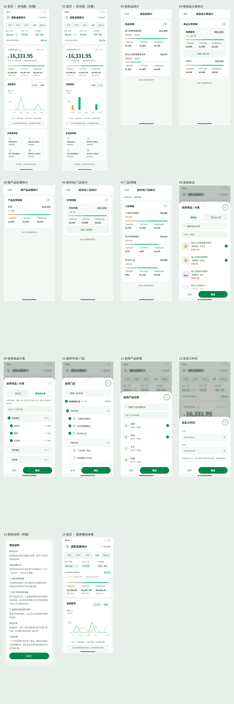

# 退款金额统计 · Sketch 设计文件

[下载 Sketch 文件](refund-report-mobile.sketch)（在 GitHub 文件页面点击 **Download raw file**），使用 macOS 的 Sketch 打开。

基于上一级目录的最终版 [HTML 原型](../index.html) 制作，375px 手机布局，共 14 个画板：

- 完整首页：折线图、柱状图，以及图表横滑至末尾的状态。
- 按商品、商品分类、产品经理、市场/门店统计，以及门店明细。
- 商品、分类、市场/门店、产品经理筛选与自定义时间弹层。
- 完整规则说明。

836 个文字图层、1,191 个矩形图层和 715 个矢量路径均可编辑。按区域分组，保留颜色、字号、圆角、边线、阴影、图表与图标。商品缩略图使用内嵌位图；每个画板另附一张默认隐藏并锁定的 HTML 参考截图，供对照使用。页面主体没有铺成整张图片。

文件包含入口、返回、关闭、图表切换等基础 Sketch 原型跳转。筛选计算、日期校验、图表拖动等 HTML 运行逻辑请使用原型体验；Sketch 中通过独立画板展示对应状态。



上图来自浏览器中的 HTML，作为设计对照，并非 Sketch 导出的渲染结果。字体指定为 macOS 的苹方（PingFang SC）；平台字体差异可能造成少量文字换行或间距差别。

已通过 `@sketch-hq/sketch-file-format@6.5.0` 官方 JSON Schema（文档格式版本 146）校验，以及 ZIP 完整性、图片引用、唯一 ID、画板跳转目标和关键文案检查。当前 Linux 环境无法运行 Sketch 桌面版，尚未进行桌面版打开与渲染验证。

## 重新生成

需要 Python 3、Node.js、Chromium；捕获时使用的 Chromium 路径为 `/usr/bin/chromium`。预览拼图使用 `/usr/share/fonts/opentype/noto/NotoSansCJK-Regular.ttc`。

```bash
cd output/refund-report-mobile/sketch/source
python -m pip install -r requirements.txt
npm install --no-save --package-lock=false playwright@1.62.1 @sketch-hq/sketch-file-format@6.5.0
node capture.cjs
python build.py
python validate.py
```

若只从已保存的页面数据重建，直接执行 `python build.py`，无需重新运行浏览器。`scenes.json` 保存最终 HTML 的页面几何、样式与文本；`manifest.json` 保存来源 SHA-256 和图层数量。更新 HTML 后请先重新捕获。

文件结构模板参考 `@sketch-hq/sketch-file-format`（MIT，Sketch B.V.）。HTML 中图标和商品缩略图的许可见 [THIRD_PARTY_NOTICES.md](../THIRD_PARTY_NOTICES.md)。
